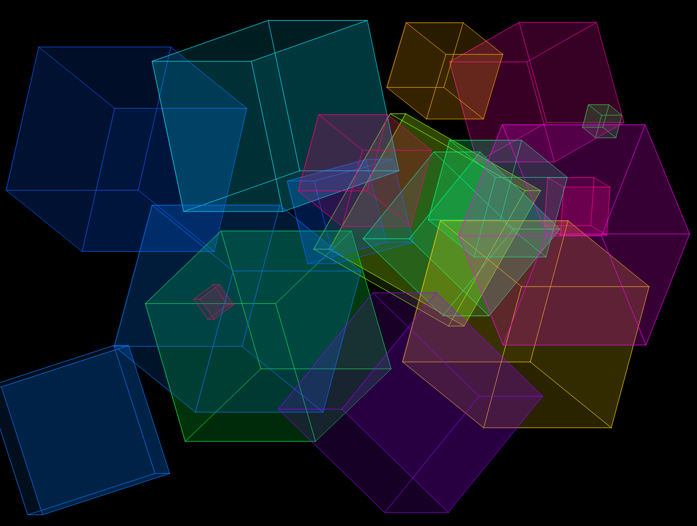
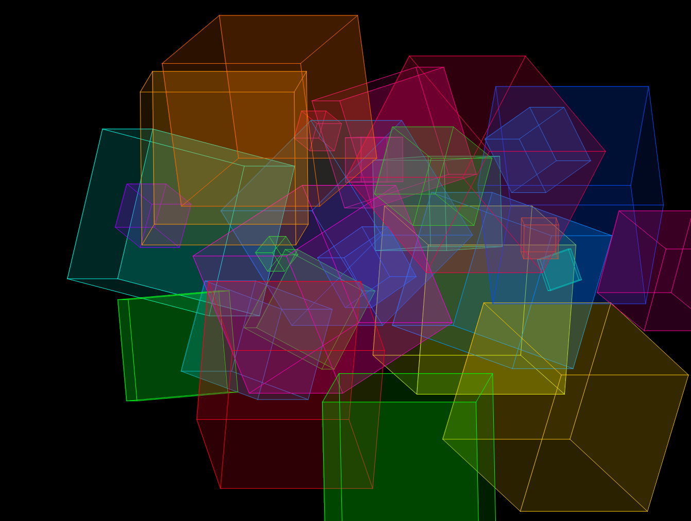

# realrap

**real random password** 

Built for Windows.
Each cube gets a secret 32-bit seed from the OS's cryptographic random generator. Its character is a SHA-256 hash of that seed plus the cube's rotation, size and position, so spinning a cube rerolls its character.

- The password is masked and color-coded displayed
- Copied passwords are wiped from the clipboard after 30s or on exit, and kept out of the Windows clipboard history (Win+V) and cloud sync
- A meter shows the current strength

<p>
    
    
</p>

## Run
Use the released windows build or:

```
pip install -r requirements.txt
python main.py
```

## Controls
| Input | Action |
|---|---|
| Right-drag | create a cube (drag sets its size) |
| Left-drag | rotate a cube, or sweep across several |
| Left-click | delete a cube |
| Arrow keys | rotate the cube under the mouse |
| Mouse wheel | zoom |
| `N` / `C` | random cube / clear all |
| `T` | toggle window transparency |
| `Esc` | quit |


## Build an .exe
```
pip install pyinstaller
pyinstaller --noconfirm --onefile --windowed --name realrap --icon assets/icon.ico --add-data "assets/icon.png;assets" main.py
```

The result is `dist/realrap.exe`. To change the icon, edit and run `make_icon.py`.
